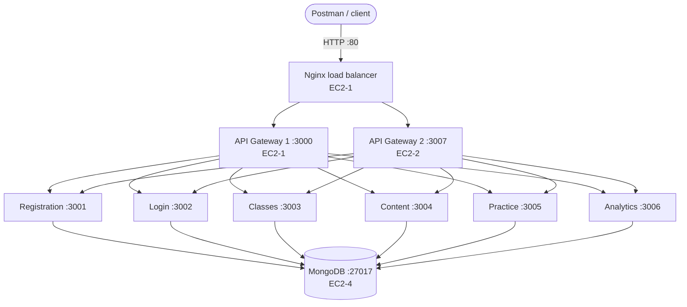

# TutorPulse

A microservices backend for STEM tutoring. Teachers turn lesson notes into practice sets, students practise with up to three clues per question, and every attempt feeds an analytics service that shows which concepts a class is struggling with.

- **7 Node.js microservices** behind an API Gateway with **JWT authentication and role-based access control**
- **MongoDB**: one database per service
- **Docker** on **4 AWS EC2 instances**, with an **Nginx load balancer** in front of two gateway replicas
- **Roles:** `admin`, `teacher`, `student`

## Architecture



| EC2 instance | Runs |
|---|---|
| EC2-1 Edge | Nginx load balancer, API Gateway 1 |
| EC2-2 Core | API Gateway 2, Registration, Login |
| EC2-3 Learning | Classes, Content |
| EC2-4 Data | Practice, Analytics, MongoDB |

**How a request flows:** Nginx sends `/api/*` to one of the two gateways (round robin with failover). The gateway checks the JWT and the caller's role against a deny-by-default rule table, then forwards the request with the user's id, role and an internal key. Services reject any request without that key, so they cannot be called around the gateway.

## Services

| Service | Port | Database | Base path | What it does |
|---|---|---|---|---|
| API Gateway (x2) | 3000 / 3007 | — | `/api` | JWT check, role rules, rate limiting, routing |
| Registration | 3001 | `tp_auth` | `/api/auth/register`, `/api/users`, `/api/admin/users` | Sign-up, profiles, admin user management |
| Login | 3002 | `tp_login` | `/api/auth/login`, `/api/auth/history` | Issues JWTs, login history, lockout after 5 failed attempts |
| Classes | 3003 | `tp_classes` | `/api/classes` | Classes, join codes, rosters, teacher feedback and meetings |
| Content | 3004 | `tp_content` | `/api/content` | Practice sets, AI question generation (Groq), study assistant |
| Practice | 3005 | `tp_practice` | `/api/practice` | Answers graded on the server, up to 3 clues, progress and reset |
| Analytics | 3006 | `tp_analytics` | `/api/analytics` | Gap Radar, ranking, CSV export, intervention plans |

Every collection supports create, read, update and delete (attempts, login records and events are history, so they are deleted but not edited). Deleting a user, class or practice set cleans up the related data in the other services.

<details>
<summary><b>Full API list</b></summary>

All paths go through `http://<EC2-1-PUBLIC-IP>`.

**Registration**
| Method | Path | Role |
|---|---|---|
| POST | /api/auth/register | public |
| GET, PUT | /api/users/me | any |
| POST, GET | /api/admin/users | admin |
| GET, PUT, DELETE | /api/admin/users/:id | admin |
| PATCH | /api/admin/users/:id/role | admin |

**Login**
| Method | Path | Role |
|---|---|---|
| POST | /api/auth/login | public |
| GET | /api/auth/me | any |
| GET, DELETE | /api/auth/history | any |
| DELETE | /api/auth/history/:id | any |

**Classes**
| Method | Path | Role |
|---|---|---|
| POST | /api/classes | teacher |
| GET | /api/classes, /api/classes/:id | any |
| PUT, DELETE | /api/classes/:id | teacher (owner) |
| POST | /api/classes/join, /api/classes/:id/leave | student |
| POST | /api/classes/:id/regenerate-code | teacher (owner) |
| GET | /api/classes/:id/students | teacher (owner) |
| DELETE | /api/classes/:id/students/:studentId | teacher (owner) |
| POST | /api/classes/:id/feedback | teacher (owner) |
| GET | /api/classes/:id/feedback, /:fid | any (member) |
| PUT, DELETE | /api/classes/:id/feedback/:fid | teacher (owner) |
| POST | /api/classes/:id/feedback/:fid/respond | student |

**Content**
| Method | Path | Role |
|---|---|---|
| POST, GET | /api/content/classes/:classId/sets | teacher (GET also student) |
| GET | /api/content/sets/:id | teacher, student (answers hidden) |
| PUT, DELETE | /api/content/sets/:id | teacher (owner) |
| POST | /api/content/sets/:id/publish, /regenerate | teacher (owner) |
| POST | /api/content/assistant | any |
| POST | /api/content/feedback-template | teacher |

**Practice** (student)
| Method | Path |
|---|---|
| GET | /api/practice/sets/:setId, /progress, /attempts |
| POST | /api/practice/sets/:setId/questions/:qi/attempt |
| POST | /api/practice/sets/:setId/questions/:qi/clue |
| DELETE | /api/practice/sets/:setId/questions/:qi/attempts |
| DELETE | /api/practice/sets/:setId/progress |

**Analytics**
| Method | Path | Role |
|---|---|---|
| GET | /api/analytics/classes/:classId/radar, /students, /concepts, /matrix, /export.csv | teacher, admin |
| GET | /api/analytics/classes/:classId/ranking | any (member) |
| POST, GET | /api/analytics/classes/:classId/interventions | teacher (GET also admin) |
| GET, PUT, DELETE | /api/analytics/classes/:classId/interventions/:id | teacher (GET also admin) |

</details>

## Run locally

```bash
cp .env.example .env                      # fill in the change-me values
COMPOSE_PROFILES=all docker compose up -d --build
npm run test:all                          # runs all automated tests against http://localhost
```

## Deploy on EC2

1. **Security group:** open 22 and 80 to the internet; open 3000–3007 and 27017 only to the same security group.
2. **On each instance**, run the setup script with that instance's role (`edge`, `core`, `learning` or `data`):
   ```bash
   curl -fsSL https://raw.githubusercontent.com/VanMeysorng/tutorpulse/main/scripts/ec2-setup.sh \
     | sudo ROLE=<role> EDGE=<ip> CORE=<ip> LEARN=<ip> DATA=<ip> JWT=<secret> INTERNAL=<secret> \
            MONGOPW=<password> ADMINPW=<password> GROQ=<key> bash
   ```
   Use the private IPs, and start in this order: `data`, `learning`, `core`, `edge`.
3. **Test in Postman:** import `scripts/TutorPulse.postman_collection.json`, set `baseUrl` to `http://<EC2-1-PUBLIC-IP>`, and run folders 0–9 in order.

## Load balancing

`nginx/default.conf.template` balances requests across both gateways. Call `GET /health` a few times and the `X-Served-By` header alternates between `gateway-1` and `gateway-2`. If one gateway is stopped, the other keeps answering.

## Project structure

```
services/     one folder per microservice (gateway, registration, login, classes, content, practice, analytics)
common/       shared app setup, auth helpers and config
nginx/        load balancer config
scripts/      Postman collection and EC2 setup script
tests/        automated test suites
web/          optional demo UI (not part of the backend)
```
